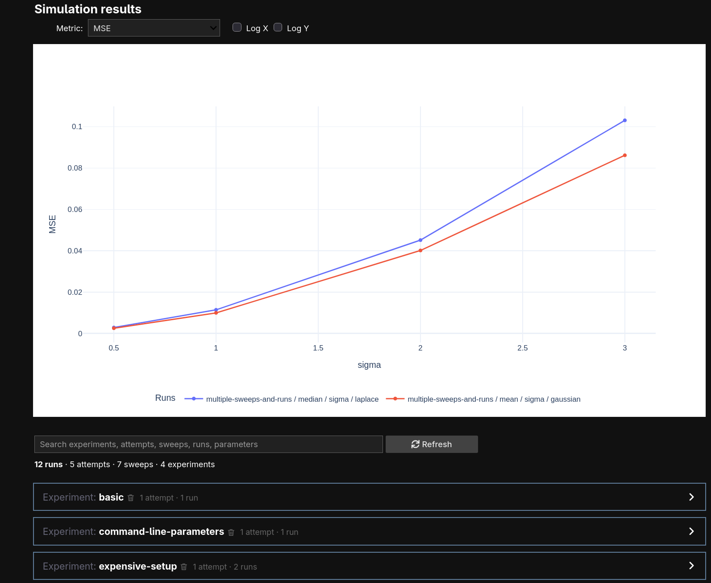
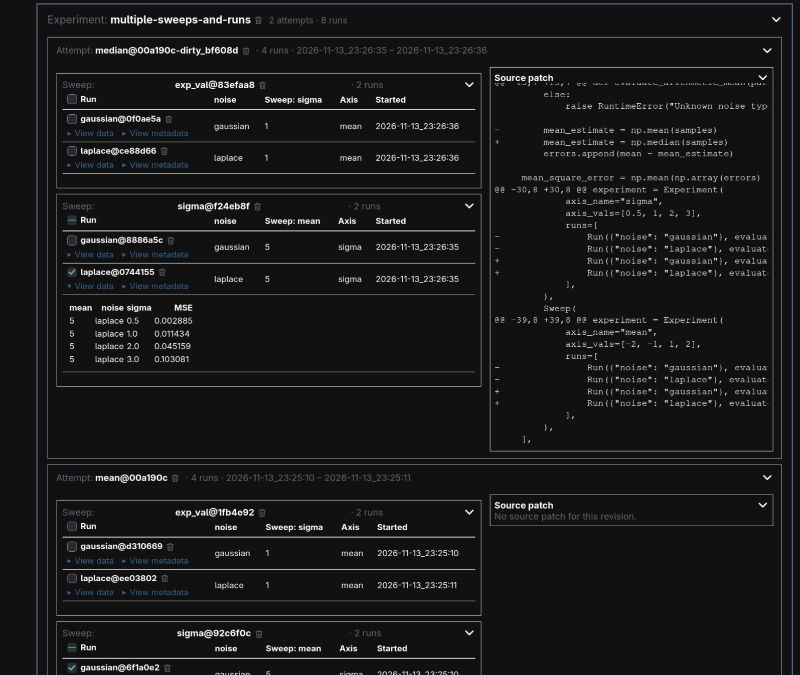

# Coordinator

`coordinator` is a thin simulation managemenet framework that aims to simplify
the organisation and visualization of results.
Simulations are structured based on `experiments`, `attempts`, `sweeps`, and
`runs`. For example:

```text
Experiment: Estimation of the expected value
├── Attempt 1: arithmetic mean
│   ├── Sweep 1: sigma = 0.5, 1, 2, 3; outliers = 5%
│   │   ├── Run A: Gaussian ordinary noise
│   │   └── Run B: Laplace ordinary noise
│   └── Sweep 2: outliers = 0%, 5%, 10%, 20%; sigma = 1
│       ├── Run A: Gaussian ordinary noise
│       └── Run B: Laplace ordinary noise
└── Attempt 2: median
    ├── Sweep 1: sigma = 0.5, 1, 2, 3; outliers = 5%
    │   ├── Run A: Gaussian ordinary noise
    │   └── Run B: Laplace ordinary noise
    └── Sweep 2: outliers = 0%, 5%, 10%, 20%; sigma = 1
        ├── Run A: Gaussian ordinary noise
        └── Run B: Laplace ordinary noise
```

- A `run` contains the datapoints corresponding to one curve plotted over
  the sweeped variable.
- A `sweep` is a collection of runs sweeped over the same variable, with
  different parameters each time.
- An `attempt` is one instance of trying out some modification of the
  algorithm being simulated. An attempt may include multiple sweeps.
- An `experiment` groups several attempts.

New attempts are created automatically when code changes are detected.
Both different git commit hashes and different dirty repo states are counted
as code changes.
See [storing simulation results](storing-simulation-results) below
for more details.
A file named `.coordinatorinclude` can be used to speficy which files count
toward code changes, with `.gitignore` syntax.
If the file doesn't exist, `coordinator` defaults to the files considered by
git, i.e., the files that are not `.gitignore`d.

New datapoints are appended to existing results and the resimulation of points
that already exist is skipped.

## Browse results in JupyterLab

Copy `notebooks/results_browser.ipynb` into your project and run it.




## Usage

```py
import numpy as np
from coordinator import Experiment, Run, Sweep, run


def evaluate_arithmetic_mean(params) -> dict:
    errors = []

    for _ in range(10000):
        mean = params["mean"]

        if params["noise"] == "gaussian":
            samples = mean + np.random.normal(scale=params["sigma"], size=100)
        elif params["noise"] == "laplace":
            samples = mean + np.random.laplace(scale=params["sigma"], size=100)
        else:
            raise RuntimeError("Unknown noise type")

        mean_estimate = np.mean(samples)
        errors.append(mean - mean_estimate)

    mean_square_error = np.mean(np.array(errors) ** 2)
    return {"MSE": mean_square_error}


experiment = Experiment(
    "estimate_expected_value",
    [
        Sweep(
            params={"mean": 5},
            axis_name="sigma",
            axis_vals=[0.5, 1, 2, 3],
            runs=[
                Run({"noise": "gaussian"}, evaluate_arithmetic_mean),
                Run({"noise": "laplace"}, evaluate_arithmetic_mean),
            ],
        ),
        Sweep(
            params={"sigma": 1},
            axis_name="mean",
            axis_vals=[-2, -1, 1, 2],
            runs=[
                Run({"noise": "gaussian"}, evaluate_arithmetic_mean),
                Run({"noise": "laplace"}, evaluate_arithmetic_mean),
            ],
        ),
    ],
)

run(experiment)
```

More examples can be found in the `examples/` directory.

## Storing Simulation Results

Results are identified by IDs that depend on several inputs such as
simulation parameters, git commit hashes, etc., as visualized in the block
diagram below.
If any of the inputs to one of the blocks change, this and all subsequent
blocks' IDs also change, ensuring all relevant datapoints are resimulated
under the new parameters.

```text
                          +-----------------+
git HEAD commit hash ---> |                 |
git source patch -------> |   Attempt ID    |
   (files tracked by      |                 |
   coordinator only)      +--------+--------+
                                   |
                                   v
                          +-----------------+
Axis name --------------> |                 |
Axis values ------------> |    Sweep ID     |
Sweep params -----------> |                 |
                          +--------+--------+
                                   |
                                   v
                          +-----------------+
                          |                 |
Run params -------------> |     Run ID      |
                          |                 |
                          +-----------------+
```

The results are stored according to the scheme below.
Attempts, sweeps and runs can have an optional label.
Note, however, that the labels are purely cosmetic and don't influence the ID
or resimulation behavior.

```text
results/
└── <experiment_name>/
     └── [<label>@]<attempt_id>/
           ├── source.patch  # Only when the worktree is dirty
           └── [<label>@]<sweep_id>/
                  └── [<label>@]<run_id>/
                        ├── data.csv
                        └── metadata.json
```
